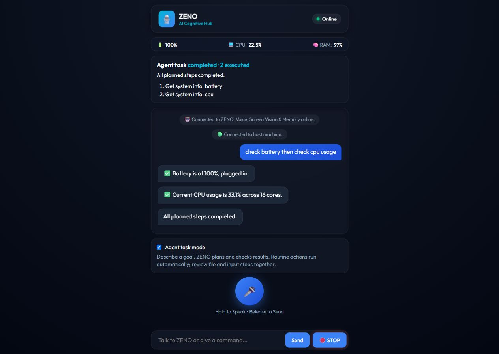

# ZENO voice-to-task upgrade

## Reference interpretation

The supplied Instagram reel (De3cuaRCm6i) was viewable in the browser. Observed
scenes included a music interface and a Claude Code panel with a website-building
instruction. The reel's media/audio export failed, so a complete audio transcript
was not available. The implementation follows the user's stated goal—turn spoken
requests into coordinated computer actions—and the observed scenes. It is not a
claim to reproduce every capability shown in the clip.

## Implemented flow

Microphone or phone speech → text → task goal → validated plan → exact-step approval
where needed → executor → recorded results → next phase or completion.

`brain/agent.py` plans a phase with Gemini or translates explicit commands offline.
`executor/agent_runner.py` owns execution for both interfaces, enforces limits,
retains desktop ownership while an in-flight OS operation finishes, and sends
progress events. It rejects an invalid phase before any action and prevents repeating
an attempted action during replanning. Tool schemas come from the existing planner.

`main.py` keeps a single microphone reader alive while the task runs. Approval replies
are routed to a pending future. A speech-generation guard rejects captures overlapping
local TTS. `server/app.py` keeps receiving approval and stop messages while execution
runs off the event loop. Permissions are scoped to the requesting connection; a
disconnect cancels that connection's task. High-risk remote actions require two
confirmations. Fresh-install authentication now initializes missing secrets.

The phone interface includes agent mode, phase plans, execution counts, interim
transcripts, and a stop button inside the approval dialog. Supported additions include
bounded waits and OS media keys.

## Verification

User story: a user submits a spoken/transcribed task through the UI, approves a
concrete phase when required, and receives execution results and a terminal task state.

| Boundary | Evidence |
|---|---|
| UI → authentication | Browser login succeeded against a loopback verification server. |
| UI → authenticated WebSocket | Agent-mode request reached the real Python runtime. |
| Runtime → executor | “check battery then check cpu usage” executed both actual read-only system queries. |
| Results → UI | UI showed battery/CPU results and “completed · 2 executed”. |
| Denial | “type Verification text” displayed exact parameters; Deny ended with “cancelled · 0 executed”. |
| Browser script | JavaScript syntax check passed; browser reported no console errors during the flow. |
| Automated task coverage | Offline compound commands, literal casing, blocked nested actions, full-phase validation, denial, failure dependencies, result-driven continuation, repeated-step/step-budget guards, cancellation during approval and execution, model-output validation, and authenticated WebSocket protocols. |

Tests use mocked model outputs and desktop mutations. No live Gemini key was available
for verification, and physical microphone recognition was not tested. The actual
browser smoke check used read-only telemetry and denied the typing request.

Final automated run: **90 passed**, with three dependency deprecation warnings.
`git diff --check` passed. Local tests also verify two distinct high-risk confirmations,
discarding speech captured across a TTS utterance, and continued listening for stop
while a command is active. The temporary verification server was stopped afterward.

## Boundaries

The runtime supports its registered actions, rather than unrestricted computer use.
It can create text/code files through file tools but cannot yet independently drive
Claude Code or reliably navigate arbitrary websites. A tool's successful dispatch is
not proof that an application finished loading or a media player changed playback.
The model is instructed to report these limits and ask for missing information.

Requests and tool outputs, including requested file contents, are sent to Gemini
when complex planning is enabled. Images are omitted from task-planning history.
No new provider or external account connection was introduced.
