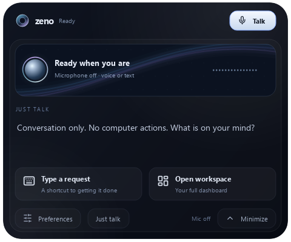

# Assistant experience

ZENO takes inspiration from the composed, result-first delivery of the fictional
JARVIS and the compact voice/text interactions of Siri. It retains its own name,
icons, voice configuration and original native graphics. This is not a movie
voice model, a Siri integration, or an expansion of unsupported automation powers.
Apple's [Siri activation guide](https://support.apple.com/en-euro/guide/mac-help/mchlb66b4ad6/mac)
informed the emphasis on explicit activation, shortcuts and a visible voice state.

## New controls

- **Assistant personality** in dashboard Preferences offers Focused, Warm and
  Balanced. Choose one and select **Apply profile**. The reply confirms the saved
  choice; the dropdown is a selection control, not a readout of stored settings.
  You can also type `assistant profile focused`, `assistant profile warm` or
  `assistant profile balanced` in normal command mode. Preferences are saved in
  the existing memory file. Balanced remains the default for existing installs.
- Focused favors precise, concise answers and actual outcomes. Warm favors a
  relaxed conversation. Safety and the current request take priority over either.
  No honorific, fictional identity, actor imitation or unobserved progress is added.
- The island has its own **Assistant / Just talk** toggle. It applies to that
  island's typed requests, Talk button and activation shortcut for the current
  session. Dashboard mode is selected independently. Just talk cannot run computer
  actions; switch back for tasks. Modes cannot change while a request is busy.
- **Escape**, while the island has keyboard focus, stops an active request or
  collapses an idle panel. It is not a global keyboard hook. Existing shortcut,
  Stop and request-bound approval controls continue to work.
- Ask **What can you do?** for a grounded capability summary even if the provider
  is unavailable. This describes supported tools, not verified model availability.

## Visual feedback

The original native orb uses a soft metallic core, thin spectrum rim and restrained
motion. Listening, transcribing, thinking, working, approval, speaking and coding
phases have specific labels. The native capture flag comes from actual stream
callbacks; a state name alone cannot light the microphone or show a live level.
Other orb/bar motion is decorative status animation, not measured speech energy
or a progress percentage. Dashboard headings follow native lifecycle events.
Reduced motion retains a static indicator. Hover collapse and cursor tracking are
retained, and the native dashboard mode selector now accepts pointer input.

This preview uses the native offscreen renderer, with no microphone or provider
call. It depicts an idle interface, not evidence of a successful voice task.

## Upgrade and verification

Restart desktop mode and refresh any browser page. No additional package, model,
account, environment variable or voice download is needed for this increment.
Profiles are prompt configuration for the existing provider, not trained model
weights. Voice output still uses the configured TTS backend and language.

Fake-provider and offscreen tests cover profiles, capabilities, capture indicators,
island mode/keyboard routing and dashboard preferences. Live microphone, speech
quality, model availability, human conversation quality and Windows user-session
smoke checks remain pending. See [setup](setup.md), [companion privacy](companion.md)
and [launch readiness](launch-readiness.md). This push is a source update, not a
commercial release or license decision.
