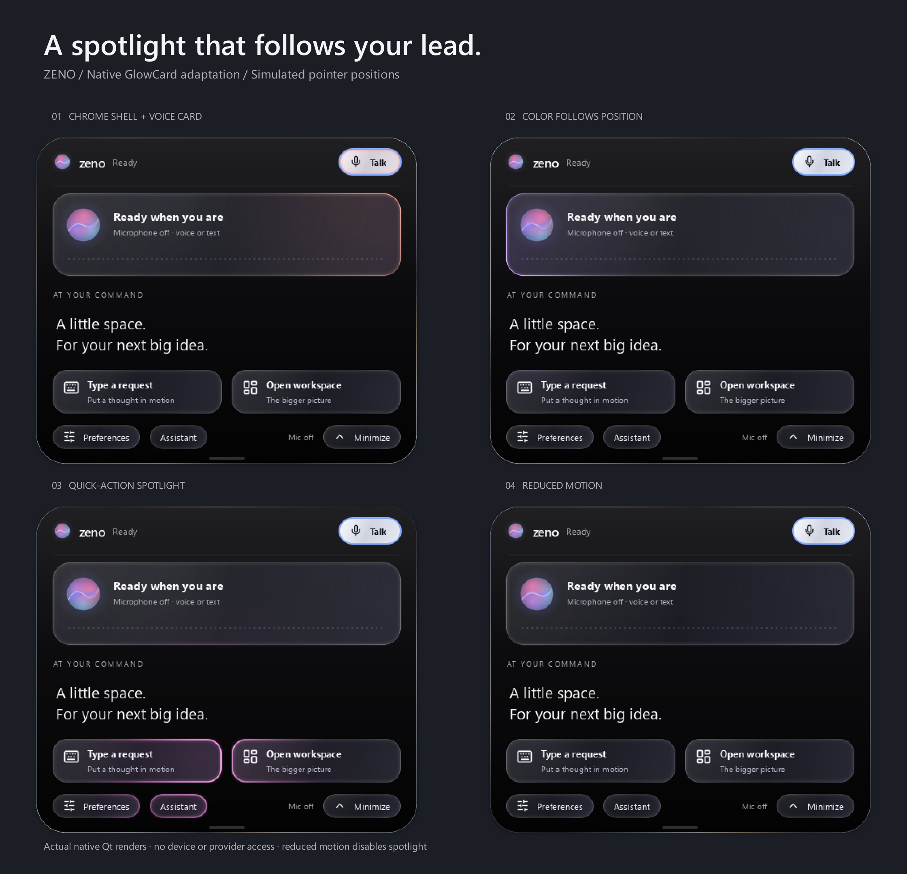
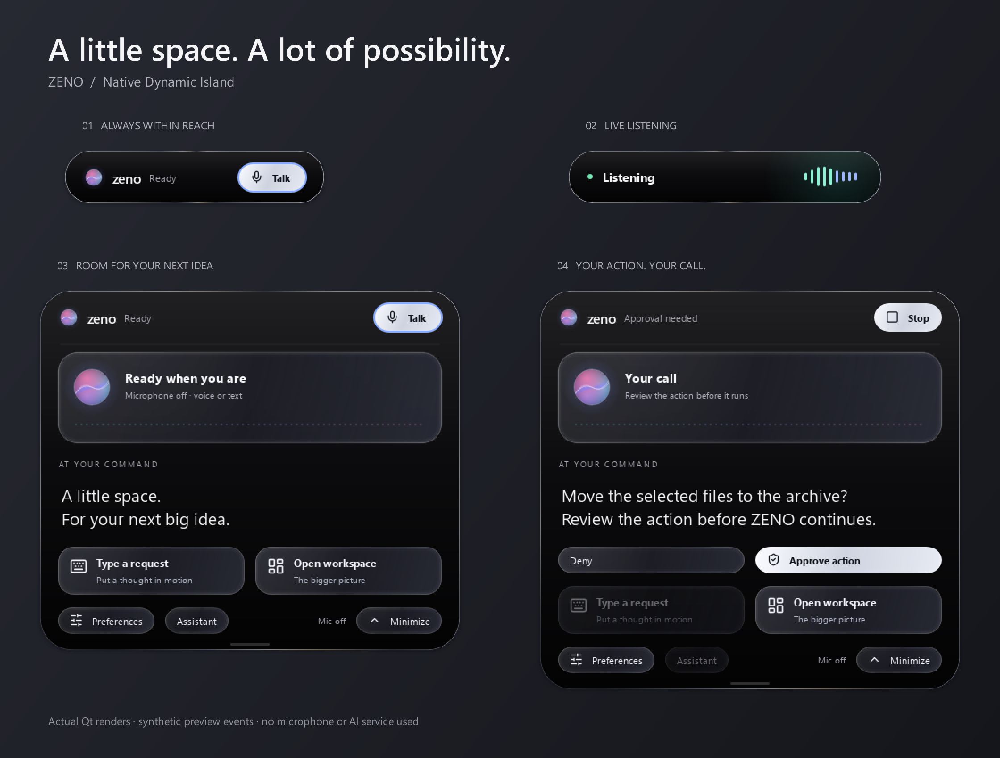

# Native Dynamic Island

The outer shell now adapts the
[Liquid Metal Button by johuniq](https://21st.dev/@johuniq/components/liquid-metal-button)
and its [Joly UI source reference](https://www.jolyui.dev/docs/components/buttons/liquid-metal-button):
a black center inside a narrow polished chrome frame. Silver/slate reflection
bands travel continuously around the perimeter in an approximately 12-second
seamless loop; the pointer adds a white specular glint. The metal band is 0.75px
wide, half the previous 1.5px thickness, with matching thinner bevels.
The same finish applies to compact, listening and expanded states. The interior
keeps the [liquid-glass controls](liquid-glass.md) and spotlight cards.

The metal is original local Qt path/gradient drawing in `paint_metal_shell`, not
the reference's React/WebGL shader or an imported source asset. It uses the
existing ambient timer and pauses with the hidden island. Reduced motion renders
a static frame and disables the pointer glint. No shader package, model/API call,
extra window or settings migration is needed. Restart desktop mode to load it.

The supplied `spotlight-card.tsx` / `GlowCard` is now adapted into the native
island too. Its 200px radial wash, colored border bloom and white hotspot follow
the pointer across the voice card and action controls. The blue palette's
hue shifts with horizontal position on the current screen. The existing ambient
timer maps the same smoothed pointer into each child, including over buttons;
there are no additional listeners or input-blocking overlays. Disabled controls
keep their quiet treatment. Reduced motion removes the spotlight immediately.

This is Qt painting in `desktop/island_components.py`, driven by
`desktop/overlay.py`. ZENO's native island does not compile React, TypeScript,
Tailwind or shadcn files, so a `/components/ui` folder would not render the supplied
TSX. The supplied component is implemented in the active native renderer; it
requires no npm packages, stock images or web runtime. The dashboard is unchanged
by this spotlight addition.

Run `python scripts/preview_island.py --spotlight` with the project environment
to reproduce the native renders with simulated pointer positions and a reduced
motion comparison. The preview does not move the real pointer or access devices
or providers.

ZENO's desktop overlay now uses a deep-black pill, a locally drawn aurora orb,
soft expansion, neutral action tiles and a subtle home indicator. The expanded
panel preserves the Talk/Stop/Retry control, text entry, conversation mode,
Preferences, workspace link and request-bound approval controls.

## Component references

Reviewed the [21st.dev community library](https://21st.dev/community/components),
its [Spectrum UI Dynamic Island](https://21st.dev/@arihantcodes_1f7b8c4d/components/dynamic-island)
and the [SmoothUI Dynamic Island](https://smoothui.dev/docs/components/dynamic-island).
The compact activity pill, eased expansion and rounded actions informed this
design. These references are React/Motion components; ZENO uses original native
Qt drawing and its existing signal/controller lifecycle. No upstream React source,
web runtime, reference images or service requests are bundled. The existing Lucide
icons retain their notices in `desktop/assets/icons/LICENSE-lucide`.
ZENO's license remains undecided.

## Behavior

- Idle: hover to expand; leave to collapse after 550 ms unless typing or reviewing an approval. Expansion reverses from
  its current geometry and remains horizontally centered.
- Capture: a 360px pill (or the screen's available width minus margins) appears
  only after the microphone-open event. The green dot and measured-level waveform
  identify capture. Click the pill to reveal Stop and other controls.
- Expanded: orb color drifts while motion is enabled. The waveform stays quiet
  without active capture; processing is identified by the phase text.
- Approvals: remain expanded until answered or cleared by the controller. Long
  prompts scroll; input and approval rows grow the panel to fit.
- Reduced motion: geometry changes immediately, the orb and waveforms remain
  static, and pointer glow is disabled. Keyboard focus remains visibly outlined.

Quit and restart desktop mode to load the changes. Existing dependencies, settings,
accounts, microphone choices and stored data are unchanged. The dashboard remains
a separate window. See [setup](setup.md) and [desktop controls](desktop.md).

## Reproducible visual verification

Run `python scripts/preview_island.py` with the project environment. This renders
the real Qt widgets offscreen, with synthetic lifecycle and microphone-level
events. It does not access an audio device, model provider or OS action.
The script registers installed Windows Segoe UI fonts for the offscreen plugin.

Desktop and dashboard regression tests cover routing, approvals, focus flags,
hover reversal, adaptive panels and capture lifecycle. Native Windows compositor,
real microphone recognition and provider availability remain manual checks.
