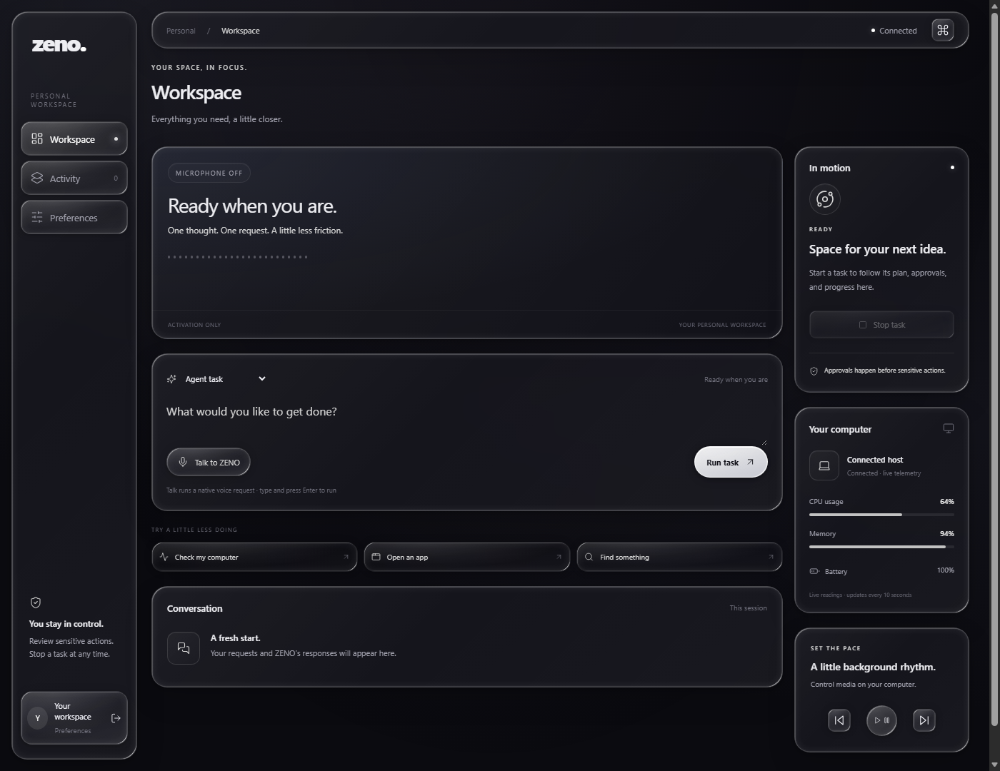

# Liquid-glass UI

The user-supplied `liquid-glass-button.tsx` informed the layered inset reflections,
frosted surfaces, press feedback and glass controls across ZENO. This includes the
shared browser/native workspace, activity, Preferences, sign-in and approval
dialogs, media controls, audit page, native tray menu, and Dynamic Island.

## Integration paths

ZENO serves HTML/CSS/JavaScript and paints its island in Qt. It does not have a
React, TypeScript, Tailwind or shadcn build pipeline. The supplied React component
is adapted into the active interfaces rather than installed as an unused TSX file.

- `server/static/liquid-glass.css` is the shared web material/control layer,
  loaded after the base stylesheet. It styles dynamically inserted controls too.
- `server/templates/index.html` owns a single decorative SVG glass filter.
  The source's displacement is reduced to keep small controls readable.
- `desktop/dashboard.py` embeds the same CSS after native density adjustments.
  The privileged dashboard continues to load only bundled local assets.
- `desktop/island_components.py` owns `paint_liquid_surface` and `GlassButton`.
  The overlay and voice card use this common native painter too.
- `server/templates/audit.html` shares the web material without loading dashboard
  scripts or changing audit authorization.

The React snippet's `/components/ui` and `@/lib/utils` paths only apply to a React
application configured with that import alias. Creating those folders in ZENO
alone would not compile or render the component. This adaptation needs no Radix,
CVA, npm runtime or new build step. Existing Lucide assets/notices remain bundled.

## Interaction and rendering

Web controls use transparent gradients, backdrop blur and layered inset shadows.
On supported browsers, fine-pointer hover adds the supplied SVG optics to the
decorative layer. Unsupported browsers retain the CSS reflections and blur.
Labels and icons are never displaced, and decorative layers ignore pointer input.
Primary, disabled, selected, destructive and keyboard-focus states remain distinct.

The native island paints its reflections locally, with a subtle change on hover,
a pressed offset and visible focus rings. It does not sample desktop pixels or
claim OS-level backdrop blur. Existing voice, approval and controller behavior
is retained. Dashboard Reduce motion also controls the island; system/browser
reduced-motion preferences disable web transitions and press movement.

## Upgrade and verification

Quit ZENO from the tray, then run `Start-ZENO.cmd` or the documented desktop
command. Refresh browser pages. There are no new dependencies, accounts,
configuration, data locations or migrations. Keep the new stylesheet with the
other bundled static files when copying a checkout.

Run these with the project environment:

```powershell
.\.venv\Scripts\python.exe scripts/check_docs.py
.\.venv\Scripts\python.exe -m pytest tests/test_desktop.py tests/test_dashboard_island.py tests/test_agent_server.py -q
.\.venv\Scripts\python.exe scripts/preview_island.py
.\.venv\Scripts\python.exe scripts/preview_liquid_ui.py
```

The last command requires installed Microsoft Edge on Windows. It checks the
actual Qt dashboard's desktop/390px layout and renders frozen DOM snapshots in
headless Edge, using an isolated ignored profile under `scratch/liquid-ui`.
Application scripts are removed from snapshots; no request or approval is sent.
It also renders browser sign-in and audit markup without authentication/data.
Native island previews use synthetic capture events. Real microphone/provider
checks remain manual. ZENO's licensing and launch-readiness status are unchanged.



See the [current island preview](island-21st-preview.png).
